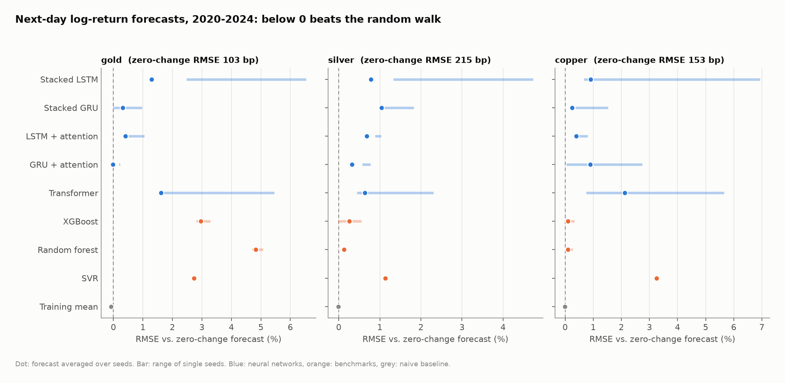
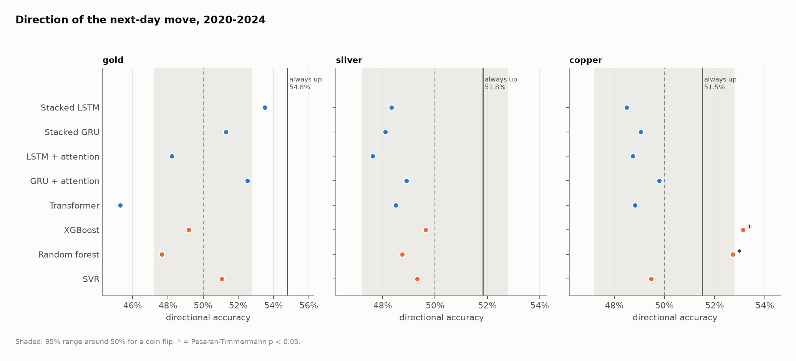

# Commodities forecasting with neural networks

[](https://github.com/QBKFD/COMMODITIES-FORECAST-NN/actions/workflows/tests.yml)

Code for my Master's thesis, *Forecasting Commodity Markets Using Neural
Networks: A Quantitative Study Using Engineered Inputs and Deep Learning
Architectures*.

The models forecast the next-day return of **gold**, **silver** and
**copper** from two inputs: a 30-day window of market features (prices,
technical indicators, volatility) and a window of macro and cross-market
features (rates, inflation, money supply, S&P 500, dollar index, VIX,
geopolitical risk). Recurrent networks, attention-based hybrids and a
Transformer are compared with XGBoost, random forest and SVR, and with the
naive forecasts every daily-return model has to beat.

## Results

Walk-forward evaluation over 2020-2024: each year is forecast by models
trained only on earlier data, one day ahead, every trading day. Neural
networks use the average forecast of three seeds.

| Model | Gold ΔRMSE | Gold DA | Silver ΔRMSE | Silver DA | Copper ΔRMSE | Copper DA |
|---|---:|---:|---:|---:|---:|---:|
| Stacked LSTM | +1.3% | 53.5% | +0.8% | 48.3% | +0.9% | 48.5% |
| Stacked GRU | +0.3% | 51.3% | +1.0% | 48.1% | +0.2% | 49.1% |
| LSTM + attention | +0.4% | 48.2% | +0.7% | 47.6% | +0.4% | 48.7% |
| GRU + attention | -0.02% | 52.5% | +0.3% | 48.9% | +0.9% | 49.8% |
| Transformer | +1.6% | 45.3% | +0.6% | 48.5% | +2.1% | 48.8% |
| XGBoost | +3.0% | 49.2% | +0.3% | 49.6% | +0.1% | 53.1%\* |
| Random forest | +4.8% | 47.6% | +0.1% | 48.7% | +0.1% | 52.7%\* |
| SVR | +2.7% | 51.1% | +1.1% | 49.3% | +3.3% | 49.5% |
| *Training mean* | -0.1% | 54.8% | -0.01% | 51.8% | -0.01% | 51.5% |
| *Always up* | – | 54.8% | – | 51.8% | – | 51.5% |
| *Zero change (reference)* | 103 bp | – | 215 bp | – | 153 bp | – |

ΔRMSE is the root mean squared error relative to forecasting a return of zero
(a random walk in prices); negative means better. DA is the share of days
with the correct sign; "always up" is the DA of always predicting a rise.
† Diebold-Mariano p < 0.05 against the zero forecast. \* Pesaran-Timmermann
p < 0.05 (the predicted signs carry information). Full tables, including
per-year results and test statistics, are in
[`output/results/`](output/results).



Single networks do worse than their average: the bars (single seeds) often
sit entirely to the right of the dot (the mean forecast of the three seeds).
Averaging pulls the forecasts towards zero, which here is the safest guess,
so results from one training run overstate the error and also the
differences between architectures.

What the numbers say:

- **No model meaningfully beats "no change".** One of the 24 model-metal combinations has
  a lower RMSE than the zero forecast over 2020-2024 (GRU + attention on gold, -0.02%),
  and none significantly (Diebold-Mariano, 5%). The worst is +4.8% (Random forest on
  gold). Year by year, a model beats the zero forecast in 24 of 120 cases.
- **Direction is close to a coin flip.** Two of the 24 combinations
  have predicted signs that carry significant information (Pesaran-Timmermann,
  5%): Random forest on copper (52.7%, p = 0.003); XGBoost on copper (53.1%, p = 0.014). With 24 tests about one false positive is expected at that
  level, so this is a lead to check on later data, not a result yet. Only
  two of the 24 beat simply predicting a rise every day.
- **No architecture wins.** The lowest RMSE belongs to GRU + attention on gold,
  Random forest on silver and Random forest on copper. The neural networks are
  -0.02% to +2.1% from the zero forecast in RMSE, the tree
  ensembles +0.1% to +4.8%.

This is the usual finding for daily returns of liquid markets, and a fair
result for the thesis: with prices, technical indicators and monthly macro
data, the next-day return is close to unpredictable.



## What changed in the evaluation

The first version of this repository reported RMSE and directional accuracy
without naive baselines, and the pipeline had several problems that made
results look better or worse than they were. They are fixed here; the
original output is kept in [`output/original_run/`](output/original_run).

- **Macro data were used before they were published.** FRED dates every
  value at the start of its period, so March CPI appeared on 1 March although
  it was released mid-April, and quarterly GDP up to four months early. Each
  monthly and quarterly series is now shifted by its usual publication lag
  ([`src/data.py`](src/data.py)). S&P 500, dollar index, VIX and the
  geopolitical risk index are lagged by one trading day, since US markets
  close after the metal futures settle.
- **The forecast was two days ahead.** The target column already held the
  next-day change, and the input window stopped one day before it. Windows
  now end on the forecast day.
- **Scalers were fitted on 2000-2024**, including the test years. They are
  now fitted inside each walk-forward fold on training data only.
- **Early stopping watched the training loss.** It now monitors the last 15%
  of each training window, held out as validation.
- **The Transformer had no positional encoding**, so self-attention treated
  the 30-day window as an unordered set. It now adds sinusoidal positions and
  residual connections.
- **Target in dollars.** Gold went from $280 to $2,700, so errors in different
  years were not comparable. The target is now the log return.
- **Smaller fixes:** the stacked LSTM imported `GRU` but called `LSTM`;
  XGBoost ignored `subsample` and `colsample_bytree` from its config; SHAP
  ran behind an interactive prompt that blocked batch runs (now `--shap`).

## Models

| Name in the code | Architecture |
|---|---|
| `stacked_lstm`, `stacked_gru` | three recurrent layers on the market window, two on the macro window, fused by dense layers |
| `lstm_attention`, `gru_attention` | recurrent layers on the market window, self-attention on the macro window, then cross-attention from market to macro (formerly `tf_tft_*`; inspired by, but not, the Temporal Fusion Transformer) |
| `transformer` | self-attention encoders with positional encoding on both windows, then cross-attention |
| `xgboost`, `random_forest`, `svr` | on the flattened windows |

The old model names (`tf_transformers`, `tf_hybrid_lstm`, ...) still work.
The NeuralForecast models in `notebooks/notebook_nn_pyt.ipynb` (Informer,
Autoformer, PatchTST, TimesNet, NHITS) and `main_nn.py` were not part of this
rerun.

## Running it

```bash
conda env create -f environment.yml && conda activate env_comm   # full environment
pip install -r requirements-test.txt                             # or: just what this pipeline needs

pytest                                                           # ~2 min

# one model, one commodity, with per-year metrics next to the zero forecast
python main.py --model transformer --config config/con_transformers.json --commodity gold --seeds 0 1 2

# everything (about 5 hours on two CPU cores; resumable), then tables and figures
python scripts/run_experiments.py
python scripts/summarise.py
```

## Repository layout

```
├── config/                 hyperparameters and feature lists per model
├── data/                   daily data for gold, silver, copper (2000-2024)
├── main.py                 train and evaluate one model
├── notebooks/              EDA, data preparation, NeuralForecast models
├── output/
│   ├── predictions/        daily forecasts per commodity, model and seed
│   ├── results/            summary.csv, by_year.csv
│   ├── figures/
│   └── original_run/       output of the first version, for comparison
├── scripts/                run_experiments.py, summarise.py
├── src/
│   ├── data.py             loading, release-date alignment, target
│   ├── train_tf.py         walk-forward training
│   ├── evaluation.py       metrics, baselines, Diebold-Mariano, Pesaran-Timmermann
│   ├── architectures/      the models
│   └── plotting.py
└── tests/
```

## Next steps

Next-day direction is close to unforecastable from prices and monthly macro
data alone, which is what the table shows. Directions that are more likely to
add information:

- **Macro surprises with exact release times:** actual minus consensus for
  CPI, payrolls and FOMC decisions from an economic calendar. These replace
  the estimated publication lags and capture what markets react to.
- **News text:** daily sentiment and topic features from financial news,
  encoded with a pretrained language model (e.g. FinBERT), available before
  the close.
- **Better-suited targets:** next-week realised volatility or large-move
  probability, where these inputs have more predictive power than for the
  sign of tomorrow's return.
- **Missing drivers:** real yields (10-year TIPS) for gold, futures term
  structure, CFTC positioning, and China PMI for copper.
