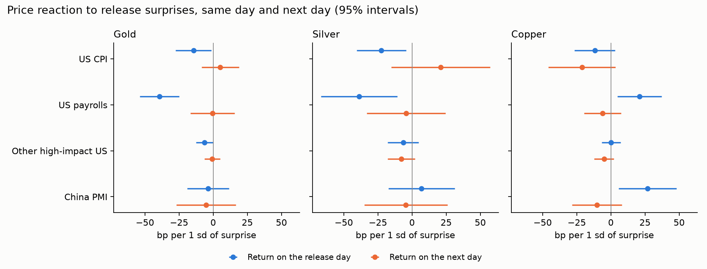
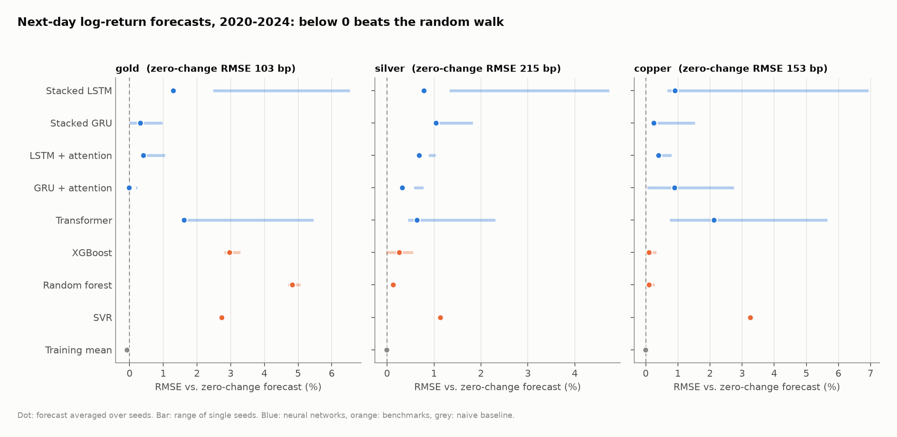
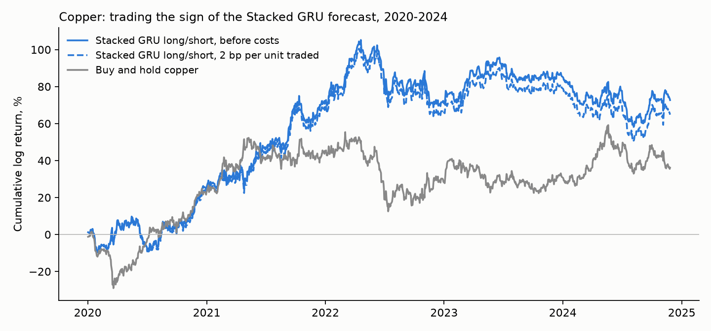

# Commodities forecasting with neural networks

[](https://github.com/QBKFD/COMMODITIES-FORECAST-NN/actions/workflows/tests.yml)

Code for my Master's thesis, *Forecasting Commodity Markets Using Neural
Networks: A Quantitative Study Using Engineered Inputs and Deep Learning
Architectures*, and the work I did on it after submitting.

The thesis asked whether neural networks can forecast the next-day return of
**gold**, **silver** and **copper** from market features (prices, technical
indicators, volatility) and macro and cross-market features (rates,
inflation, money supply, S&P 500, dollar index, VIX, geopolitical risk).
Recurrent networks, attention-based hybrids and a Transformer are compared
with XGBoost, random forest and SVR, and with the naive forecasts every
daily-return model has to beat.

After the thesis I rebuilt the evaluation, removed look-ahead bias that made
the original results look better than they were, and added an
economic-calendar study to understand why the forecasts fail.

## In short

1. **Macro surprises move metals on the day they are released, in the
   direction economics predicts.** A one standard deviation upside surprise
   in US payrolls moves gold by -39 bp (t = -5.3) and copper by +21 bp. Five
   of twelve release and metal pairs survive a Benjamini-Hochberg correction.
2. **The move is over by the next day.** None of the twelve pairs has a
   next-day effect, and adding the surprises to the forecasting models
   changes their RMSE by less than 0.35%.
3. **No model forecasts next-day returns better than "no change".** Over
   2020-2024 none of the 24 model and metal combinations beats the zero
   forecast significantly, and a Model Confidence Set cannot tell any of them
   apart from it.
4. **Volatility is forecastable.** A simple HAR model beats the historical
   average on all three metals (Diebold-Mariano, all p < 0.05), and absolute moves
   are 13-28% larger on release days.
5. **One direction signal is statistically real but not worth trading.** The
   stacked GRU gets copper's sign right on 55.3% of days (Holm-adjusted
   p = 0.004), but trading it gives a Sharpe ratio that is not significantly
   above zero (p = 0.08) and is negative in 2022 and 2024.

Put together: news arrives through scheduled releases and is priced on the
same day, so a model that forecasts tomorrow from today's data has very
little left to work with. What these inputs do predict is *how much* prices
move, not which way.

## Thesis and after

The thesis compared the models with the original pipeline, whose output is
kept in [`output/original_run/`](output/original_run). After submitting I
found that it used macro data before it was published, fitted scalers on the
test years and forecast two days ahead instead of one, among other things
(see [What changed since the thesis](#what-changed-since-the-thesis)).
Everything below uses the corrected pipeline and was done after the thesis:

| Step | Where |
|---|---|
| Fix look-ahead and evaluation, add naive baselines, significance tests and unit tests | PR #2, first corrected results in [`output/fixed_evaluation/`](output/fixed_evaluation) |
| Economic-calendar surprise features and the with/without-events ablation | PR #3 |
| Stationary inputs, revised architectures, tuning on validation years, full rerun, event study, volatility, robustness checks | PR #4 |

## 1. Macro surprises move metals on the release day

For each release the surprise is the actual value minus the consensus
forecast, divided by the standard deviation of *earlier* surprises of the
same release. I regress the return over the day the release became public
(settlement to settlement, so the announcement falls inside it) on the
surprise, and do the same for the next day's return. Days without a release
have a surprise of 0. Sample 2010-2024, Newey-West standard errors (5 lags),
Benjamini-Hochberg (BH) across the twelve pairs.

Move on the release day, in bp per one standard deviation of surprise
(t-statistic in brackets):

| Release | Gold | Silver | Copper |
|---|---:|---:|---:|
| US payrolls | **-39** (-5.3) | **-39** (-2.7) | **+21** (2.6) |
| US CPI | -14 (-2.1) | **-22** (-2.4) | -12 (-1.5) |
| China PMI | -4 (-0.5) | +7 (0.6) | **+27** (2.5) |
| Other high-impact US | -6 (-1.9) | -7 (-1.1) | 0 (0.0) |

Bold: BH-adjusted q < 0.05. On the next day nothing is significant (all
q ≥ 0.64).

The signs make sense. Stronger US jobs or inflation data raise expected
interest rates and the dollar, and gold and silver pay no yield, so they
fall. Copper is an industrial metal: strong payrolls and a strong Chinese
PMI mean more demand, so it rises. The "other" group mixes releases where a
higher number means different things, so its average slope is hard to read.
Fed rate decisions are left out because too few had a consensus to score.



Table: [`output/results/event_study.csv`](output/results/event_study.csv).
Script: [`scripts/event_analysis.py`](scripts/event_analysis.py).

## 2. Next-day returns: no model beats "no change"

Walk-forward evaluation over 2020-2024: each year is forecast by models
trained only on earlier data, one day ahead, every trading day. Neural
networks use the average forecast of three seeds.

| Model | Gold ΔRMSE | Gold DA | Silver ΔRMSE | Silver DA | Copper ΔRMSE | Copper DA |
|---|---:|---:|---:|---:|---:|---:|
| Stacked LSTM | +0.09% | 53.5% | -0.07% | 51.8% | +0.24% | 50.2% |
| Stacked GRU | -0.44% | 53.4% | +0.32% | 50.9% | +0.37% | 55.3%‡ |
| LSTM + attention | -0.11% | 55.0% | +0.05% | 50.3% | +0.12% | 50.7% |
| GRU + attention | -0.12% | 53.7% | +0.08% | 52.7% | +0.09% | 51.6% |
| Transformer | -0.08% | 54.1% | +0.02% | 51.8% | +0.07% | 53.0%\* |
| XGBoost | +0.27% | 53.7% | +1.03% | 49.3% | +0.80% | 53.2%\* |
| Random forest | -0.11% | 54.4% | +0.69% | 51.9% | +0.81% | 53.1%\* |
| SVR | +0.09% | 52.7% | +0.31% | 50.7% | +0.06% | 52.1% |
| *Training mean* | -0.09% | 54.8% | -0.01% | 51.8% | -0.01% | 51.5% |
| *Always up* | – | 54.8% | – | 51.8% | – | 51.5% |
| *Zero change (reference)* | 103 bp | – | 215 bp | – | 153 bp | – |

ΔRMSE is the root mean squared error relative to forecasting a return of
zero (a random walk in prices); negative means better. DA is the share of
days with the correct sign. No ΔRMSE is significant (Diebold-Mariano, 5%).
\* Pesaran-Timmermann p < 0.05 (the predicted signs carry information).
‡ Also significant after a Holm correction for the 24 tests.

- **Nothing beats the zero forecast.** Six of the 24 combinations have a
  slightly lower RMSE, the best being the stacked GRU on gold (-0.44%,
  p = 0.11). None is significant, before or after correcting for 24 tests.
  Year by year, a model beats the zero forecast in 50 of 120 cases.
- **The models cannot be told apart.** A Model Confidence Set (Hansen,
  Lunde and Nason 2011) on squared error, over the eight models plus the
  zero and training-mean forecasts, keeps every one of them in the 90% set
  for every metal.
- **Direction is close to the base rate.** On gold only LSTM + attention
  beats predicting a rise every day, by 0.2 points. Copper is the exception
  and gets its own section below.
- **The revised pipeline made the models better behaved, not better.** In
  the first corrected run the worst model was 4.8% worse than the zero
  forecast. Now it is 1.0%, and all the networks are within 0.5%.



The bars are single seeds and the dot is their average forecast. Averaging
pulls the forecasts towards zero, which here is the safest guess, so single
runs look worse and differ more between architectures than they really do.
The stacked GRU on gold is an example: its -0.44% comes from the average,
while single seeds range from -0.22% to +0.14%.

Tables: [`summary.csv`](output/results/summary.csv),
[`by_year.csv`](output/results/by_year.csv),
[`multiple_testing.csv`](output/results/multiple_testing.csv),
[`model_confidence_set.csv`](output/results/model_confidence_set.csv).
Direction accuracy figure:
[`directional_accuracy.png`](output/figures/directional_accuracy.png).

## 3. Event features do not improve the forecasts

The ablation trains four models (GRU + attention, Transformer, XGBoost,
random forest) on all three metals with three seeds, once with and once
without the economic-calendar columns, both from March 2010, and compares
them on the same 2020-2024 days.

- RMSE changes range from -0.12% to +0.32%. Eight of twelve lean slightly
  towards the events arm.
- One Diebold-Mariano p-value is below 0.05 (Transformer on copper, -0.11%,
  p = 0.039). With twelve tests it does not survive a correction (BH
  q = 0.29).
- On the 157 release days alone the changes stay within ±0.55%, and
  direction accuracy moves by at most 1.4 points.

This is what section 1 predicts. The surprise is priced on the release day,
so by the time it is in the inputs, the return it affects has already
happened. Table:
[`event_ablation.csv`](output/results/event_ablation.csv).

## 4. Volatility is forecastable

Here the target is the size of tomorrow's move, the absolute next-day
return, with the same walk-forward test years. HAR (Corsi 2009) is a linear
regression on yesterday's absolute return and the average over the last
week and the last month. The second model adds flags for a scheduled CPI,
payroll or FOMC release inside tomorrow's window.

| | Gold | Silver | Copper |
|---|---:|---:|---:|
| RMSE of the historical mean | 71.8 bp | 154.5 bp | 100.0 bp |
| HAR vs historical mean | **-2.3%** (p = 0.02) | **-3.6%** (p = 0.002) | **-1.8%** (p = 0.003) |
| HAR + release flags vs HAR | -0.6% (p = 0.20) | -0.5% (p = 0.17) | -0.2% (p = 0.16) |
| ... on release days only | -3.3% (p = 0.19) | -3.9% (p = 0.12) | -1.6% (p = 0.11) |
| Mean absolute return, release days | 91 bp | 176 bp | 129 bp |
| Mean absolute return, other days | 71 bp | 147 bp | 114 bp |

Volatility clusters, so the size of recent moves predicts the size of the
next one, on all three metals. Release days are 13-28% more volatile, and
the release flags improve the forecast on those days for every metal,
though not significantly on their own. Unlike the return, this is a target
where a model has something to learn, so it is the natural next step.

Table: [`volatility.csv`](output/results/volatility.csv).

## 5. A closer look at copper direction

The stacked GRU's 55.3% on copper (against 51.5% for "always up") is the
only result in section 2 that survives a strict correction (Holm across the
24 sign tests, p = 0.004). To see whether it is worth anything, I traded
each model's forecast sign as a daily long/short position.

| Copper, 2020-2024 | Sharpe | Sharpe after 2 bp | Sharpe after 5 bp | p (mean > 0) |
|---|---:|---:|---:|---:|
| Stacked GRU, long/short | 0.61 | 0.55 | 0.45 | 0.08 |
| Buy and hold | 0.30 | 0.30 | 0.30 | 0.25 |

Costs are per unit traded, so a switch from long to short costs twice. The
GRU switches about 40 times a year, and its break-even cost is 18 bp per
unit, so costs are not the problem. The problem is that the profit is not
reliable. Its mean daily return is not significantly above zero, and by year
the Sharpe ratio is 1.11, 1.78, -0.01, 0.72 and -0.61 (2020 to 2024). Across
all 24 model and metal strategies none has a mean return significantly above
zero after correction (lowest BH q = 0.21).

A sign test can pass while the strategy fails because the test counts days
and the profit weights them by size. Being right on many small days and
wrong on some large ones gives a significant hit rate and a weak return. The
same thing explains why a 55% hit rate barely moves the RMSE.

So the signal looks real but small and unstable. I would not trade it. A
check on 2025 data, which the models have never seen, is the honest way to
settle whether it persists.



The backtest assumes trading at the settlement price the features are built
from, and ignores roll costs, slippage, margin and financing. Tables:
[`backtest.csv`](output/results/backtest.csv),
[`backtest_copper_gru_by_year.csv`](output/results/backtest_copper_gru_by_year.csv).
Script: [`scripts/robustness.py`](scripts/robustness.py).

## What changed since the thesis

### Evaluation fixes (PR #2)

The thesis reported RMSE and directional accuracy without naive baselines,
and the pipeline had several problems that made results look better or
worse than they were.

- **Macro data were used before they were published.** FRED dates every
  value at the start of its period, so March CPI appeared on 1 March although
  it was released mid-April, and quarterly GDP up to four months early. Each
  monthly and quarterly series is now shifted by its usual publication lag
  ([`src/data.py`](src/data.py)). S&P 500, dollar index, VIX and the
  geopolitical risk index are lagged by one trading day, since US markets
  close after the metal futures settle.
- **The forecast was two days ahead.** The target column already held the
  next-day change, and the input window stopped one day before it. Windows
  now end on the forecast day.
- **Scalers were fitted on 2000-2024**, including the test years. They are
  now fitted inside each walk-forward fold on training data only.
- **Early stopping watched the training loss.** It now monitors the last 15%
  of each training window, held out as validation.
- **The Transformer had no positional encoding**, so self-attention treated
  the 30-day window as an unordered set. It now adds sinusoidal positions and
  residual connections.
- **Target in dollars.** Gold went from $280 to $2,700, so errors in different
  years were not comparable. The target is now the log return.
- **Smaller fixes:** the stacked LSTM imported `GRU` but called `LSTM`;
  XGBoost ignored `subsample` and `colsample_bytree` from its config; SHAP
  ran behind an interactive prompt that blocked batch runs (now `--shap`).

### Revised pipeline (PR #4)

- **Stationary inputs** ([`src/features.py`](src/features.py)). Price levels,
  moving averages and dollar-valued indicators are replaced by returns,
  ratios to the current price and distances from moving averages, and macro
  levels by year-on-year changes. With levels, gold near 2,700 in the test
  years was far outside anything seen in training. M1 is dropped because it
  was redefined in May 2020.
- **Scaled inputs are clipped at 5 standard deviations**, so a handful of
  crisis days in March 2020 cannot dominate the fit.
- **The forecast is read from the last day of the window** instead of an
  average over all 30 days, and the attention blocks have residual
  connections and layer normalisation
  ([`src/architectures/blocks.py`](src/architectures/blocks.py)).
- **AdamW with weight decay and gradient clipping, and a Huber loss**, since
  daily returns have fat tails.
- **Hyperparameters chosen on 2018 and 2019 only** ([`scripts/tune.py`](scripts/tune.py)),
  five candidates per model, scored by RMSE relative to the zero forecast.
  The test years are never used. With a signal this weak a large search
  would mostly fit noise in the validation years. Results in
  [`output/tuning/`](output/tuning).

## Limitations

- The test period is five years, 2020-2024, which includes the COVID shock
  and the 2022 rate cycle. Other periods may behave differently.
- The consensus forecasts come from Forex Factory calendar exports, a proxy
  for what the market expected.
- The event study uses daily settlement-to-settlement returns, so it cannot
  separate the reaction to a release from other news on the same day.
- The volatility target is the absolute daily return, a noisy measure of
  volatility. Realised volatility from intraday data would be more precise.
- The hyperparameter search is small on purpose, so some models may be a
  little better with more tuning. Given the Model Confidence Set result, I
  do not expect this to change the conclusions.
- The backtest is a test of whether the forecast sign is worth anything,
  not a trading strategy (see the assumptions in section 5).

## Next steps

- **Volatility models.** Compare HAR, GARCH, LSTM and Transformer models,
  and pretrained time-series foundation models (Chronos, TimesFM), on the
  volatility target, scored with QLIKE and a Model Confidence Set against
  HAR. This is the fair test of whether neural networks add anything here.
- **Intraday event study.** With minute data the reaction to each release
  can be measured over 5 to 60 minutes instead of a whole day, which gives
  much sharper estimates.
- **Out-of-sample check of copper direction** on 2025 data.
- **Missing drivers:** real yields (10-year TIPS) for gold, futures term
  structure and CFTC positioning.

## Models

| Name in the code | Architecture |
|---|---|
| `stacked_lstm`, `stacked_gru` | three recurrent layers on the market window, two on the macro window, fused by dense layers |
| `lstm_attention`, `gru_attention` | recurrent layers on the market window, self-attention on the macro window, then cross-attention from market to macro (formerly `tf_tft_*`; inspired by, but not, the Temporal Fusion Transformer) |
| `transformer` | self-attention encoders with positional encoding on both windows, then cross-attention |
| `xgboost`, `random_forest`, `svr` | on the flattened windows |

The old model names (`tf_transformers`, `tf_hybrid_lstm`, ...) still work.
The NeuralForecast models in `notebooks/notebook_nn_pyt.ipynb` (Informer,
Autoformer, PatchTST, TimesNet, NHITS) and `main_nn.py` were not part of
this rerun.

## Economic-calendar features

`src/events.py` adds release-level information from an economic calendar
(Forex Factory exports, 2010-2024) to the macro inputs:

| column | meaning |
|---|---|
| `z_cpi`, `z_nfp`, `z_fed_rate`, `z_usd_other`, `z_china_pmi` | surprise (actual - consensus) of releases that became public since the previous settlement, divided by the standard deviation of *earlier* surprises of the same release; 0 on days without one |
| `next_cpi`, `next_nfp`, `next_fomc` | 1 if a scheduled CPI, payroll or FOMC release falls between today's and tomorrow's settlement, i.e. inside the return being forecast |

Timing is what makes or breaks features like these, so:

- The exports store times in the timezone of the browser that scraped them
  (UTC+8 up to 2023, Brussels from 2024). `check_timezones` converts them and
  confirms that every payroll release lands at 8:30 New York and every
  scheduled FOMC statement between 12:00 and 14:30.
- Releases are assigned to trading days by the COMEX settlement time (13:30
  New York for gold and silver, 13:00 for copper), not by calendar date. An
  FOMC statement at 14:00 is after the gold settlement, so it only enters the
  next day's inputs.
- Only release *dates* are used ahead of time, and those are published
  months in advance. The two unscheduled cuts of March 2020 are not flagged.
- Chinese PMIs (released around 9:00 Beijing, the evening before in New York)
  are included for copper's sake; all models see the same columns.

The raw calendar files are not redistributed (`data/calendar_raw/` is ignored
by git). `data/events/event_surprises.csv` holds only what the features need:
release name, UTC time and standardised surprise.

## Running it

Python 3.11 (TensorFlow 2.17 does not support 3.13).

```bash
pip install -r requirements-test.txt     # what this pipeline needs (CPU only)
pytest                                   # ~2 min

# one model, one commodity, with per-year metrics next to the zero forecast
python main.py --model transformer --config config/con_transformers.json --commodity gold --seeds 0 1 2

# the full study
python scripts/run_experiments.py        # all models, metals and seeds (about 5 hours on two CPU cores; resumable)
python scripts/summarise.py              # summary.csv, by_year.csv and figures
python scripts/robustness.py             # multiple testing, Model Confidence Set, backtest
python scripts/event_analysis.py         # event study and volatility

# optional
python scripts/tune.py run && python scripts/tune.py select   # redo the tuning on 2018-2019

# event ablation: put forex_factory_calendar_<year>.csv into data/calendar_raw/, then
python scripts/build_event_features.py   # timezone check + data/events/event_surprises.csv
python scripts/run_event_ablation.py     # each model with and without the event columns (72 jobs)
python scripts/compare_event_ablation.py # output/results/event_ablation.csv
```

The full research environment, including NeuralForecast for the notebook
models, is in `environment.yml` (`conda env create -f environment.yml`).

## Repository layout

```
├── config/                 hyperparameters and feature lists per model (tuned)
├── data/                   daily data for gold, silver, copper (2000-2024)
│   └── events/             release times and standardised surprises (derived)
├── main.py                 train and evaluate one model
├── notebooks/              EDA, data preparation, NeuralForecast models
├── output/
│   ├── predictions/        daily forecasts per commodity, model and seed
│   ├── results/            all result tables
│   ├── figures/
│   ├── tuning/             validation scores of every candidate
│   ├── fixed_evaluation/   first corrected run (PR #2), for comparison
│   └── original_run/       output of the thesis version
├── scripts/                experiments, summaries, event study, robustness, tuning
├── src/
│   ├── data.py             loading, release-date alignment, target
│   ├── features.py         stationary inputs
│   ├── train_tf.py         walk-forward training
│   ├── evaluation.py       metrics, baselines, Diebold-Mariano, Pesaran-Timmermann, Holm and BH
│   ├── events.py           economic-calendar surprises and release flags
│   ├── architectures/      the models
│   └── plotting.py
└── tests/
```
